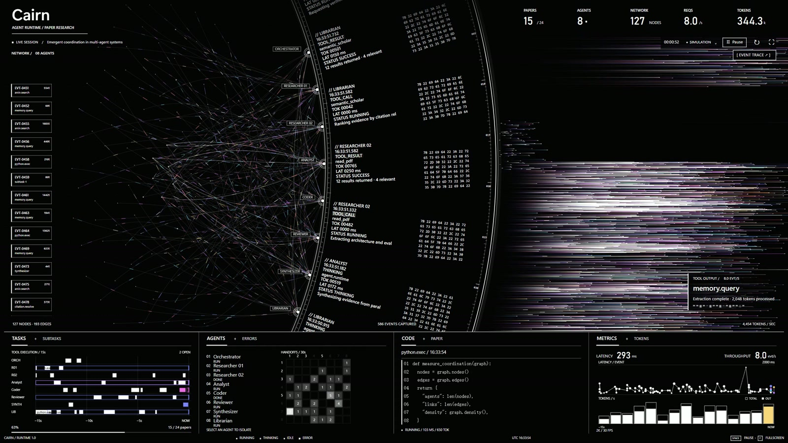

<div align="center">

<p><sub>AGENT RUNTIME / PAPER RESEARCH</sub></p>
<h1>Cairn</h1>
<p><strong>See your agents work.</strong></p>
<p>把消息、工具调用与输出流，放在同一个运行现场。</p>

<p>
  <code>Vanilla JavaScript</code> &nbsp;·&nbsp;
  <code>Canvas · SVG · WebGL</code> &nbsp;·&nbsp;
  <code>WebSocket / SSE</code> &nbsp;·&nbsp;
  <code>零运行依赖</code>
</p>

<p>
  <a href="#快速开始">快速开始</a> &nbsp; / &nbsp;
  <a href="#四个视区八类信息">功能概览</a> &nbsp; / &nbsp;
  <a href="docs/integration.md">接入 Agent</a> &nbsp; / &nbsp;
  <a href="docs/architecture.md">实现与边界</a>
</p>

</div>



<p align="center"><sub>内置模拟会话实景 · <a href="docs/assets/cairn-motion.gif">查看 3 秒动效预览（约 1.8 MB）</a> · <a href="docs/assets/cairn-overview.jpg">查看清晰大图</a></sub></p>

## 一屏看清 Agent 运行

Cairn 是一个全屏智能体运行观测界面。它接收事件，把 Agent 之间的交接、工具执行、Token 消耗与延迟映射成连续的可视化，适合多智能体研究、工作流调试和运行演示。

- **协作关系**：Agent、工具和子任务组成消息网络，活跃流量沿连线移动。
- **执行过程**：事件字段和载荷字节排入巨大的旋转弧环，左侧事件带向上滚动、渐隐。
- **工具输出**：返回事件触发水平光束，信号以蓝、紫、粉、橙、金与白色流动。
- **可追溯数据**：执行跨度、转交矩阵、代码返回和延迟轨迹由事件更新；日志可筛选、搜索、导出。

背景、文字和刻度采用黑白高对比，动态信号保留颜色。四个底部视区贴合主场景，窄屏自动调整为两列或单列。

## 快速开始

需要本机有 **Node.js**。项目没有第三方运行依赖，无需安装依赖或构建。

```bash
git clone https://github.com/Novusaaa/cairn-observatory.git
cd cairn-observatory
npm start
```

打开 **[http://127.0.0.1:4173](http://127.0.0.1:4173)**，即可看到模拟研究会话。

> 默认数据源明确标记为 `SIMULATION`。接入自己的 Agent 时，通过顶部数据源入口切换到 WebSocket 或 SSE。

## 四个视区，八类信息

每个视区包含两个页签，保留信息密度，同时减少面板分割。

| 默认视图 | 看到什么 | 切换页签 |
| :-- | :-- | :-- |
| **TASKS** | 最近 15 秒的工具执行跨度，按 Agent 排列，可悬停查看耗时与 Token | `SUBTASKS`：委派任务及状态 |
| **AGENTS** | Agent 状态与最近 30 秒的 source → target 转交矩阵 | `ERRORS`：错误及发生时间 |
| **CODE** | 工具实际返回的文本或代码，变化行短暂高亮 | `PAPER`：论文与研究来源索引 |
| **METRICS** | 按事件时间绘制延迟轨迹与每秒 Token 消耗 | `TOKENS`：会话累计用量、输入/输出分类及预算 |

## 接入你的 Agent

先用随仓库提供的 SSE 测试服务验证链路。在另一个终端运行：

```bash
npm run demo:sse
```

在页面顶部点击 **SIMULATION**，选择 **Server-Sent Events**，地址填写：

```text
http://localhost:8788/events
```

这个服务发送测试事件。连接成功后，将地址换成你的 Agent 后端，并按统一事件结构推送 JSON；也可以直接连接 WebSocket。

**[阅读接入指南 →](docs/integration.md)** — 事件字段、SSE 格式、浏览器 API、状态映射与暂停行为。

## 操作方式

| 操作 | 效果 |
| :-- | :-- |
| 点击网络节点、Agent 条目或转交矩阵单元 | 聚焦对应 Agent，筛选相关流量和事件环 |
| 拖动网络节点 | 探索消息关系 |
| 悬停任务条、矩阵单元或延迟点 | 查看事件数值 |
| `EVENT TRACE` | 打开虚拟滚动日志，支持搜索、类型过滤和 JSON 导出 |
| `Space` / `R` / `F` | 暂停或继续 / 重启模拟 / 全屏 |
| 页签中的 `←` / `→` | 切换同组页签 |
| `TOKENS` 下方的预算入口 | 调整本地会话的 Token 预算 |

## 渲染与资源控制

**Canvas** 绘制网络与数据图，**SVG** 承载旋转事件环，**WebGL** 批量绘制输出光束，并提供 Canvas 回退。界面使用系统字体，无远程字体依赖。

<details>
<summary><strong>展开查看性能边界与暂停机制</strong></summary>

- 每秒最多 **30 批视觉更新**，高频事件按相同键合并，累计 Token 与事件数。
- 最多 **500 个可视节点**，超出后聚合；保留最近 **2,000 条合并事件**，日志采用虚拟滚动。
- 默认预算为 **2M Token**：达到 80% 提示，达到 100% 暂停本地接收。此操作不会停止远端 Agent。
- 页面隐藏时自动暂停本地观察，返回后恢复；实时连接在暂停期间关闭，期间事件不缓存、不重放。
- 尊重系统的 `prefers-reduced-motion` 设置，停止圆环转动、射线运动与冲击波。

完整的缓冲上限、渲染策略和接入约束见 **[实现与边界](docs/architecture.md)**。

</details>

## 开发与贡献

```bash
npm run check   # JavaScript 语法检查
npm test        # 事件协议、合并、更新频率、容量边界与预算测试
```

```text
cairn-observatory/
├── dist/                 页面、样式、事件引擎与渲染器
├── scripts/              本地服务、SSE 测试源与事件引擎测试
├── docs/
│   ├── assets/           界面截图与轻量动效预览
│   ├── integration.md    Agent 事件接入指南
│   └── architecture.md   实现、容量与生命周期说明
└── package.json          启动和验证命令
```

欢迎提交 [Issue](https://github.com/Novusaaa/cairn-observatory/issues) 或 [Pull Request](https://github.com/Novusaaa/cairn-observatory/pulls)。报告问题时，可附上浏览器、数据源类型和脱敏后的最小事件样例；改动视觉或交互时，附上截图更便于核对。

---

<p align="center"><sub>Cairn · 事件驱动的 Agent 运行观测</sub></p>