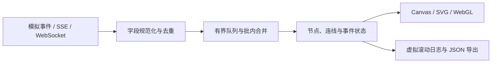

# 实现与边界

[← 返回 Cairn](../README.md) · [Agent 事件接入指南](integration.md)

Cairn 是无框架的浏览器前端。页面、事件引擎和渲染器都在 `dist/`；`scripts/serve.mjs` 只负责提供静态文件。

## 数据路径



事件协议与数据源不绑定特定 Agent 框架。后端负责将运行过程转换为统一事件，Cairn 负责接收、归并、展示与本地检查。

## 渲染分工

| 文件 | 职责 |
| :-- | :-- |
| `dist/index.html` | 主场景、视区和原生对话框 |
| `dist/app.js` | 会话生命周期、页签、筛选、预算与浏览器 API |
| `dist/engine.js` | 固定字段、事件队列、节点与连线状态、模拟源和传输 |
| `dist/field.js` | Canvas 网络、SVG 事件环、上滚事件带与基础绘图 |
| `dist/gpu-stream.js` | 批量 WebGL 输出光束与 Canvas 回退 |
| `dist/effects.js` | 工具事件触发的光波与脉冲 |
| `dist/instruments.js` | 执行跨度、转交矩阵、延迟与 Token 分桶 |
| `dist/runtime.css` / `contrast.css` / `kinetic.css` / `event-panels.css` | 布局、黑白视觉、动效与数据视区样式 |

### 主场景

网络使用力场布局，Agent 沿内侧圆弧分布，工具和子任务在网络内部活动。连线权重与信号密度受事件流量影响。

事件环由 SVG 承载，显示最近事件的固定字段与载荷字节。旋转通过分组变换执行；输出光束使用小型 WebGL 着色器批量提交，缺少 WebGL 或恢复失败时回退到 Canvas。

### 数据视区

- **TASKS**：以事件时间配对工具调用和返回，绘制最近 15 秒的执行跨度。
- **AGENTS**：按 source → target 汇总最近 30 秒的转交，单元格可查看计数与 Token。
- **CODE**：展示工具返回的内容，比较前后文本并短暂标记变化行。
- **METRICS**：按事件时间绘制延迟，并按秒汇总 Token。

其他信息通过同组页签展示，减少主场景下方的固定面板数量。

## 资源上限

| 项目 | 上限或策略 |
| :-- | :-- |
| 视觉事件更新 | 每秒最多 30 批；相同事件键在批内合并 |
| 节点 | 最多 500 个，超出部分进入聚合集群 |
| 连线 | 最多 2,500 条 |
| 待处理合并键 | 最多 1,200 个；满后不接收新增键 |
| 保留事件 | 最近 2,000 条合并事件 |
| `eventId` 去重窗口 | 最近 10,000 个 ID |
| 单次事件数组 | 最多处理前 1,000 项 |
| 输出光束 | 最多 4,500 条 |
| 事件脉冲 | 最多 23 个 |
| 场景像素密度 | 设备像素比上限 1.25 |
| 网络物理更新 | 通常约 30Hz；节点超过 300 时约 15Hz |

渲染由 `requestAnimationFrame` 驱动，实际帧率取决于设备、浏览器、窗口大小与事件密度。30 批事件更新的上限与屏幕渲染帧率是两个独立概念。

## 生命周期与数据保留

会话状态保存在浏览器内存中。刷新页面或重置模拟会清空当前观察会话；需要留存时，在 `EVENT TRACE` 中导出 JSON。

默认 Token 预算为 2M，达到 80% 提示，达到 100% 暂停本地接收。预算暂停不会停止远端 Agent。页面隐藏时自动暂停，返回后恢复；手动、预算及隐藏暂停期间的事件不缓存、不重放。

SSE 使用浏览器原生重连；WebSocket 断开后通过数据源入口重新连接。需要无损恢复和完整审计时，应在后端保存原始事件并实现补发。

## 适配与可访问性

- 桌面底部为四列，宽度不超过 800px 时为两列，不超过 520px 时为单列。
- 系统字体承担界面文字，代码与载荷字节使用等宽字体，无远程字体请求。
- 支持键盘焦点、原生模态框、页签方向键、纯文本事件检查器与图形说明。
- `prefers-reduced-motion` 停止圆环旋转、射线运动和冲击波，事件数据仍可更新。

## 验证

```bash
npm run check
npm test
```

语法检查覆盖当前入口和渲染模块；事件引擎测试覆盖字段规范化、去重与 Token 合并、30Hz 批次上限、节点聚合与内存边界、预算暂停和不可信内容处理。
